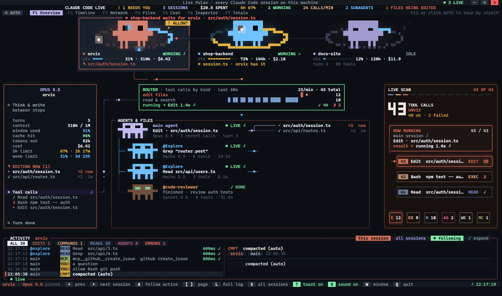
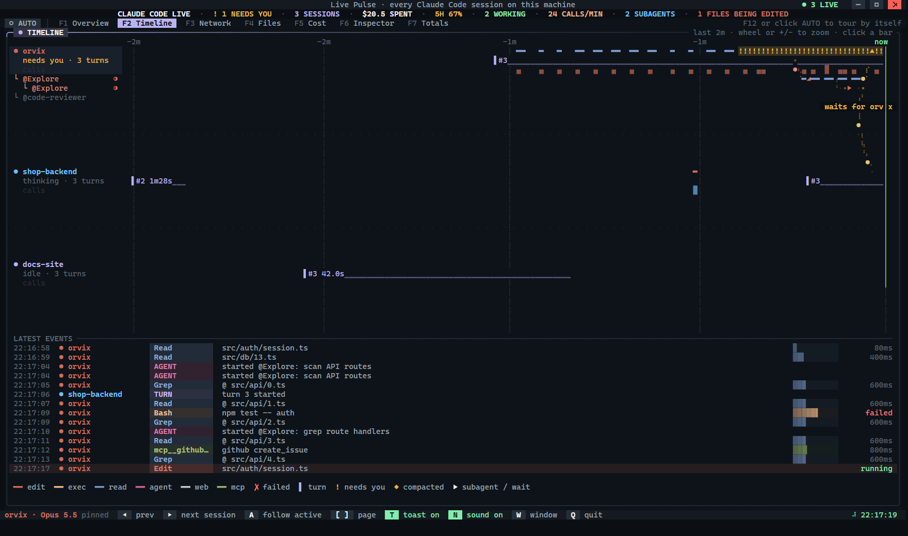
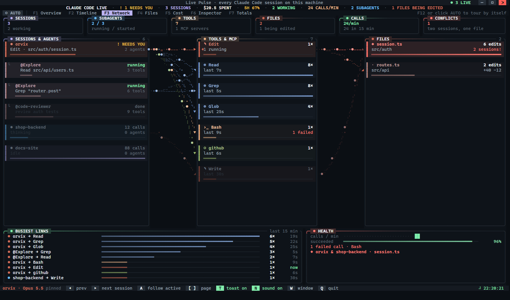
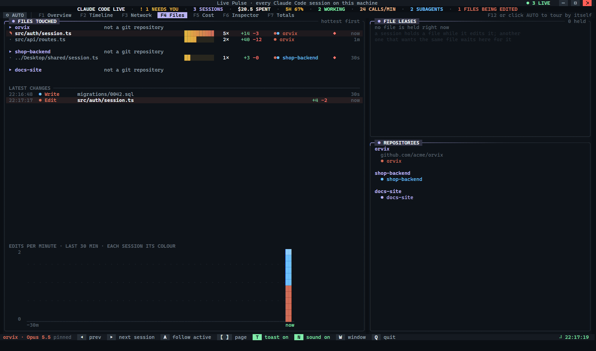
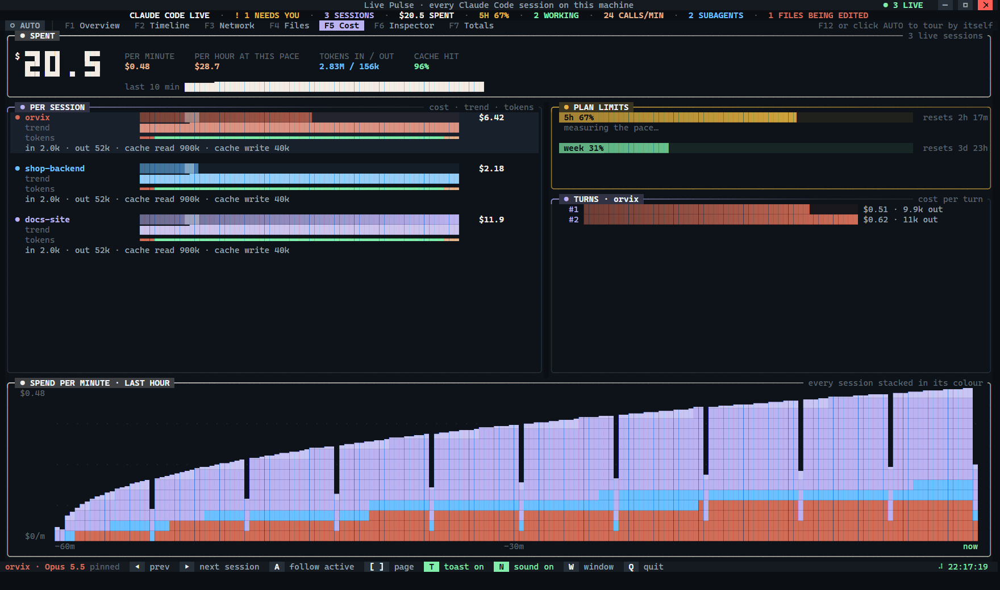
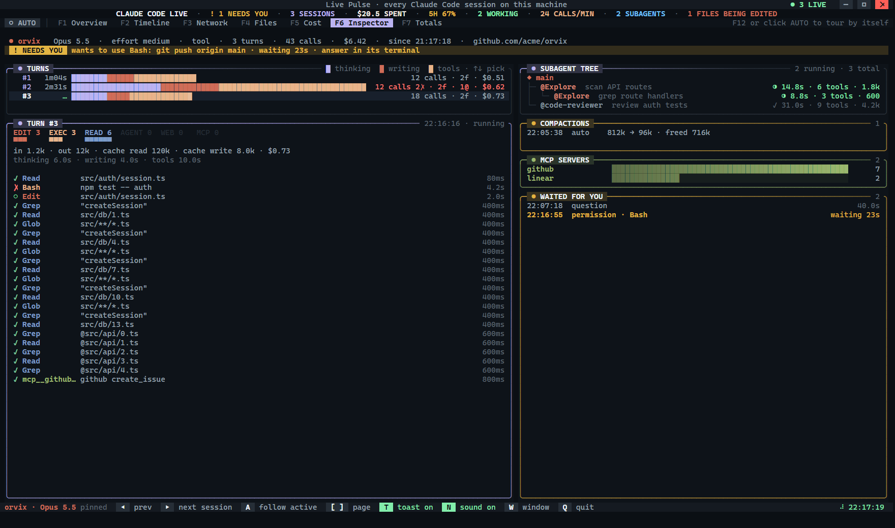
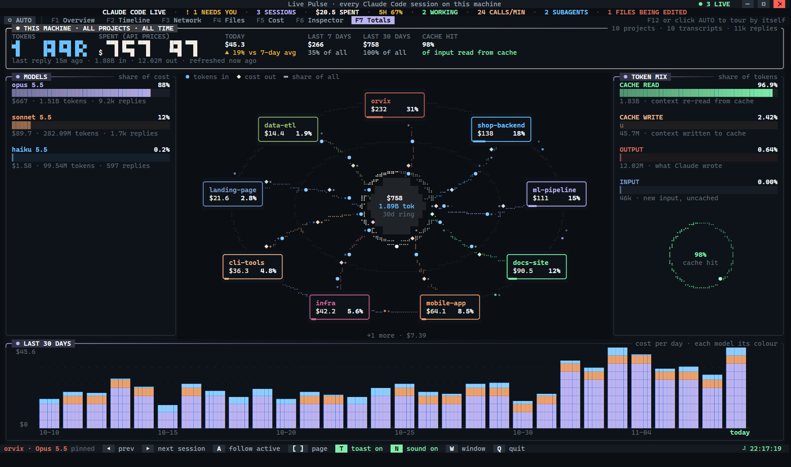
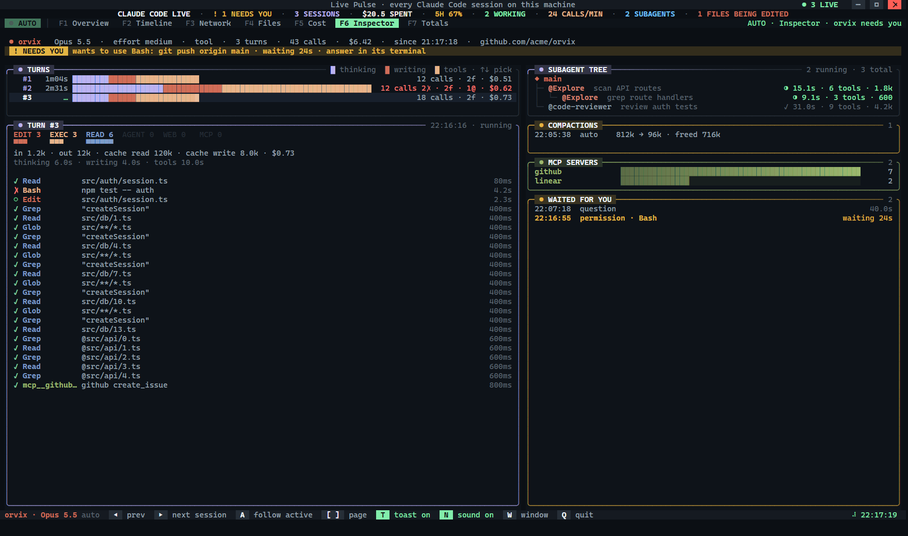

<div align="center">

# Live Pulse

### A live mission-control screen for Claude Code

See every Claude Code session on your computer at a glance: what it is doing, which files it is changing, what it costs, and the moment it needs you.

    


**[Quick start](#quick-start)** · **[The pages](#the-pages)** · **[FAQ](#faq)** · **[▶ Full demo video](https://github.com/kareem-ebrahim/live-pulse/releases/latest)**

</div>

> [!NOTE]
> Live Pulse runs on **Windows 10 and 11** with **Windows Terminal**. It does not support macOS or Linux yet.

## Contents

- [What is Live Pulse?](#what-is-live-pulse)
- [Quick start](#quick-start)
- [What you see, step by step](#what-you-see-step-by-step)
- [The pages](#the-pages)
- [AUTO mode](#auto-mode)
- [Alerts](#alerts)
- [Install, update and fix problems](#install)
- [Controls](#controls)
- [Privacy](#privacy)
- [FAQ](#faq)
- [Words used here](#words-used-here)
- [For developers](#for-developers)

## What is Live Pulse?

[Claude Code](https://claude.com/claude-code) is an AI that works in your terminal. It reads files, runs commands, edits code and starts helper agents. Most of that scrolls by in a chat, and when two or three sessions run at once it is hard to tell which one is busy, which one is stuck, which one is waiting for your *yes*, and how much it all costs.

**Live Pulse puts all of that on one live screen.** It opens in its own window, made to sit on a second monitor (or half of your screen) while you work. Every session appears as an animated pixel creature, and seven pages show the details: a timeline, a map of who talks to what, the files being changed, the cost, a deep look at one session, and totals for your whole computer.

It has two parts that install together:

| Part | What it does |
|---|---|
| **A Claude Code plugin** | Watches each session from the inside (turns, tool calls, helper agents, files, cost) and writes small status files on your computer. |
| **A dashboard window** | Reads those files ten times a second and draws them as an animated terminal display. |

Nothing leaves your computer, Live Pulse never records what you type, and it **uses no tokens** (see the [FAQ](#faq)).

## Quick start

1. Make sure you have **Windows Terminal**, **Node.js 18+** and **Claude Code** ([details](#1-requirements)).
2. In Claude Code, type:
   ```
   /plugin install live-pulse --marketplace kareem-ebrahim/live-pulse
   ```
   and choose **Install for you (user scope)**.
3. Close Claude Code and open it again. The Live Pulse window opens by itself.

## What you see, step by step

| When this happens in Claude Code | You see this in Live Pulse |
|---|---|
| You open a session in any folder | A new **pixel creature** appears in its own colour, named after the project. The ring around it fills as the conversation grows (blue, then amber, then red). |
| Claude thinks or writes | The creature moves and the status reads **THINKING** or **WRITING**. |
| Claude uses a tool (reads a file, runs a command, edits code) | A **spark** runs along a wire, and the call shows up in the activity list with its change or output. |
| Claude starts a helper agent | Sparks **burst** from the creature and a **small new creature** is born for the helper. |
| A command runs in the background (a server, a build, tests) | It gets its own creature, with its **output streaming live**. |
| Claude edits a file | The file lights up on the **Files** page, with the lines added and removed. |
| Two sessions want the same file | The second one **waits** for the first to finish, so their edits never clash. An arrow shows who is waiting for whom. |
| A session **needs you** | A **"! ALLOW?" bubble** pops over its creature and you get a **Windows notification with a sound**. |
| A long piece of work finishes | A ring pulses around the creature. If you were in another window, you get a short "done" notification. |
| You close the session | Its creature leaves the screen. |

## The pages

Switch pages with the tabs at the top, the keys **`F1`** to **`F7`**, or **`[`** and **`]`**. Or press **AUTO** and let Live Pulse switch for you.

### F1 · Overview

**Every session at a glance.**



- A creature for each session, with its project, status, how full its conversation is, and its cost so far.
- For the selected session: its helper agents wired to the files they edit, tool calls by kind in the last minute, and the activity log with real code changes and command output.
- Creatures have moods: they sleep (*z Z z*) when idle, sweat when something fails, sing after a clean finish, and raise a bubble when they need you.

### F2 · Timeline

**What happened, and when.**



- A lane for each session, and an indented lane for each of its helper agents.
- Every tool call is a bar from its start to its end, coloured by kind. ✗ marks a failure, ▌ marks the start of a turn, `!` shows how long a session waited for you, and ◆ marks a compaction.
- Arrows show which agent started which helper, and which session is waiting for which.
- Below: the latest events as a list. Zoom with the mouse wheel or `+` / `-` (2, 5, 15 or 60 minutes).

### F3 · Network

**Who talks to what.**



- **Summary cards** at the top: sessions, helper agents, tools in use, files, calls per minute and conflicts.
- **Three sections:** *Sessions & Agents* (each session with its helpers as a tree), *Tools & MCP*, and *Files*.
- **Links** between the sections carry moving particles: fast and bright while calls flow, faint when quiet, red when two sessions touch the same file.
- At the bottom: the **busiest links** of the last 15 minutes, and a **health** panel with the success rate, failed calls and conflicts.

### F4 · Files

**Which files are changing.**



- Every file the sessions touched, grouped by project, busiest first: number of edits, lines added and removed, and which sessions edited it.
- Each project's git state: branch, commits ahead or behind, and changed or untracked files (refreshed every 15 seconds).
- **File locks:** which session holds which file, and who is waiting for it.
- The latest changes, and a chart of edits per minute.

### F5 · Cost

**What it costs, and how fast.**



- The total spent by the open sessions, the cost per minute, and per hour at this pace.
- Each session's cost and tokens.
- Your plan's **5-hour and weekly limits**, with a projection: *"at this pace the 5-hour limit is reached in 1h12m"*.
- The cost of each recent turn, and a chart of spend per minute over the last hour.
- A warning when a session sat idle long enough for its cache to expire, which makes its next reply cost more.

### F6 · Inspector

**One session in depth.**



- Each turn as a bar split into time spent thinking, writing and running tools.
- The chosen turn opened up: every call, its tokens and its cost (pick a turn with `↑` `↓` or a click).
- The tree of helper agents, the compactions, the MCP servers used, and every time the session waited for you.

### F7 · Totals

**Everything Claude Code has used on this computer, across all projects.**



- Total tokens and total money for **every project and every session**, not only the open ones.
- Each project's share in percent, around a core that holds the total.
- The share of each model, the token mix, today, the last 7 days and the last 30 days, and a chart of the last 30 days.

> [!TIP]
> Money on this page is shown at **API prices**. On a Pro or Max subscription you pay your plan instead: the figure shows what the same use would cost through the API.

## AUTO mode

Press **AUTO** in the top-left corner (or **`F12`**) and the screen runs itself, like a status board:

- **It goes where the action is.** A session that needs you comes first, then a new helper agent, a burst of edits, or a plan limit running high.
- **When nothing special happens, it tours.** It shows every page and every session, about 20 seconds each, and scrolls long lists down and back up.
- The AUTO button fills up like a progress bar while each view runs, and the right side of the tab bar says what it is showing.
- Press any key or click anywhere and AUTO steps aside for a minute.



## Alerts

| Alert | When | How |
|---|---|---|
| **Needs you** | A session asks for permission, asks you a question, or has a plan for you to approve | Windows notification + sound, always |
| **Done** | A long piece of work finished | Windows notification + sound, only when the Live Pulse window is not in front |
| **Error** | Work finished with failed calls | Windows notification + sound, only when the Live Pulse window is not in front |

- In Claude Code's **auto mode**, a session that approves a command by itself does **not** alert you. You are only told when a session is really waiting for you, and the notification goes away once you answer.
- Press **`T`** to turn notifications on or off and **`N`** for the sound. The choice is saved in `~/.claude/live-pulse/settings.json`.

<h2 id="install">Install, update and fix problems</h2>

### 1. Requirements

| You need | How to check or get it |
|---|---|
| **Windows 10 or 11** | |
| **Windows Terminal** | Built into Windows 11. On Windows 10, install it from the Microsoft Store. |
| **Node.js 18 or newer** | Type `node -v` in PowerShell. If it is missing, run `winget install OpenJS.NodeJS.LTS`, then **restart the computer**. |
| **Claude Code 2.1.275 or newer** | Type `claude --version`. Update with `claude update`. |

### 2. Install

In Claude Code, type:

```
/plugin install live-pulse --marketplace kareem-ebrahim/live-pulse
```

When it asks where to install, choose the first option, **Install for you (user scope)**. That way it works in every Claude Code session, in any folder.

### 3. Start

**Close Claude Code and open it again** (or type `/reload-plugins`). The Live Pulse window opens by itself; if it does not, type `/pulse`. From now on, every Claude Code session you open appears in the same window.

> [!TIP]
> **Use it on a second screen.** The window fills the screen it is on, never under the taskbar. Drag it to your second monitor or press **`M`** to send it there. It remembers where you put it.

### Update

Close Claude Code, then run this in PowerShell:

```
claude plugin marketplace update live-pulse
claude plugin update live-pulse@live-pulse
```

Open Claude Code again. `claude plugin list` shows the version you have.

### If something does not work

| Problem | Fix |
|---|---|
| `error 2147942402 … node`, or a message that Node.js is missing | Install Node.js (see Requirements), **restart the computer**, then type `/pulse`. |
| `/plugin install` is not a command | Your Claude Code is too old. Run `claude update`. |
| Nothing happens after installing | Close Claude Code and open it again, then type `/pulse`. |
| No Windows notifications | Open **Windows Settings → System → Notifications** and allow notifications for **Windows PowerShell**. |
| The window says *widen this window* | Make the window bigger: it needs at least 100 × 34 characters. |

## Controls

### Commands in Claude Code

| Command | What it does |
|---|---|
| `/pulse` | Opens the Live Pulse window. |
| `/pulse auto` | Turns on or off opening the window **by itself** when a session starts (on by default). This is not AUTO mode. |
| `/pulse reset` | Clears this session's counters. |

### In the window

Everything works with the mouse too: click tabs, buttons, creatures and rows.

| Key | What it does |
|---|---|
| `F1` … `F7` | Go to a page |
| `[` and `]` | Previous / next page |
| `F12` or `G` | Turn AUTO mode on or off |
| `Tab` / `Shift+Tab` | Next / previous session |
| `A` | Follow the most active session |
| `T` / `N` | Notifications on or off / sound on or off |
| Mouse wheel, `↑` `↓` `PgUp` `PgDn` | Scroll, zoom the Timeline, or pick a turn in the Inspector |
| `←` `→` or `1` … `6` | Filter the activity log by kind (Overview) |
| `L` | Show the activity log at full height (Overview) |
| `M` / `W` | Move to the next monitor / switch between window and full screen |
| `Q` | Quit |

## Privacy

- Live Pulse **never records what you type** to Claude.
- It records what a session **does**: tool calls with their inputs (file paths, code changes, commands) and the first 20 lines of a command's output.
- The Totals page reads only the **numbers** Claude Code keeps with each reply (tokens, model, time and project folder), never the text.
- Everything stays on your computer, in `~/.claude/live-pulse`. It keeps the newest 600 events per session and deletes sessions older than a day.

## FAQ

<details>
<summary><b>Does Live Pulse use tokens or make Claude more expensive?</b></summary>

No. The plugin never calls the AI and never adds anything to your conversation. It only watches what happens and writes small files on your computer. The window is a separate program that reads them. The only cost is a little CPU on your own machine to draw the screen.
</details>

<details>
<summary><b>Does it slow Claude Code down?</b></summary>

No, with one deliberate exception: when two sessions try to edit the **same file** at the same moment, the second waits for the first to finish (at most 90 seconds), so their edits do not overwrite each other.
</details>

<details>
<summary><b>Is the money shown what I really pay?</b></summary>

On the **Cost** page it is the cost Claude Code itself reports for each session. On the **Totals** page it is calculated at API prices. If you pay through a Pro or Max subscription, you pay your plan price instead, and the figure shows what the same use would cost through the API.
</details>

<details>
<summary><b>Does it work on macOS or Linux?</b></summary>

Not yet. The window, the multi-monitor placement and the notifications use Windows features.
</details>

<details>
<summary><b>What is the difference between <code>/pulse auto</code> and the AUTO button?</b></summary>

`/pulse auto` decides whether the window **opens by itself** when you start a session. The **AUTO** button in the window makes the screen **tour its pages by itself**.
</details>

<details>
<summary><b>How do I remove it?</b></summary>

Close Claude Code, then run this in PowerShell:

```
claude plugin uninstall live-pulse@live-pulse
```

You can also delete the folder `~/.claude/live-pulse` to remove its saved data.
</details>

## Words used here

| Word | Meaning |
|---|---|
| **Session** | One Claude Code conversation, running in one terminal. |
| **Turn** | One round of work: you send a message, Claude works until it answers. |
| **Tool call** | One action Claude takes: reading a file, running a command, editing code, searching the web. |
| **Helper agent (subagent)** | A second Claude that a session starts to do part of the work, such as searching the code. |
| **Background command** | A command that keeps running while Claude does other things, such as a dev server. |
| **Context** | How much of the conversation Claude keeps in mind. It has a limit; the ring around a creature shows how full it is. |
| **Compaction** | When the context gets full, Claude Code summarises the conversation to free space. |
| **Cache** | Claude Code reuses the part of the conversation it already sent, which is much cheaper. After a few minutes idle the cache expires and the next reply costs more. |
| **MCP server** | An add-on that gives Claude extra tools, such as GitHub or a database. |
| **Plan limits** | The usage limits of a Pro or Max plan: one resets every 5 hours, one every week. |
| **File lock** | Live Pulse lets only one session edit a file at a time; another one waits for it. |

## For developers

<details>
<summary><b>How it works</b></summary>

```
Claude Code session ──(plugin hooks: turns, tool calls, permission prompts, agents, usage)──▶ live-pulse plugin
                                                                                                    │
                         ~/.claude/live-pulse/sessions/<id>.json    (a snapshot, 4 times a second)
                         ~/.claude/live-pulse/events/<id>/<n>.json  (one small file per event)
                                                                                                    │
Windows Terminal window ◀────────────────── dashboard/pulse-dash.mjs (30 fps, no dependencies)
                                                 └─ a worker thread reads ~/.claude/projects for Totals
```

- **`hooks/register.tsx`**: the plugin. It hooks `turn.start`, `turn.step`, `tool.call`, `tool.check`, `agent.spawn`, `turn.complete`, `session.compact`, `session.end` and the permission-prompt events, and reads cost, context and plan limits from `$.session.usage()`.
- **`dashboard/`**: the window. A diffing true-colour cell buffer, pixel creatures drawn in half blocks, fine lines in braille, a page per view (`dashboard/pages/`), the AUTO director (`director.mjs`) and the alerts (`alerts.mjs`, which shows Windows notifications and plays short chimes through PowerShell). Plain Node, no packages.
</details>

<details>
<summary><b>Run from source</b></summary>

```
git clone https://github.com/kareem-ebrahim/live-pulse
```

Add this to `~/.claude/settings.json`, with the path of your clone:

```json
"env": { "CLAUDE_CODE_PLUGIN_DIRS": "C:\\path\\to\\live-pulse" }
```

After you edit the files, `node sync.mjs` copies them to `~/.claude/live-pulse-mod`; the open window restarts with the new code. To render any page to an HTML file:

```
node dashboard/pulse-dash.mjs --html out.html --size 200x56 --page timeline
```
</details>

## License

[MIT](LICENSE)
