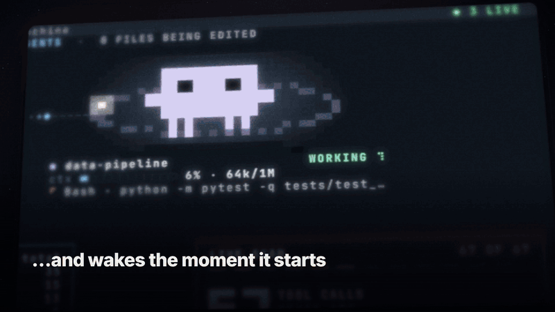

<div align="center">

# Live Pulse

**Every Claude Code session on your machine — live, in one window.**

A Claude Code mod plus a full-screen terminal dashboard for Windows Terminal: one creature per
session, every subagent wired to the files it edits, live diffs, commands and their output, and
tool calls by kind — all from real hook events.



**[▶ Watch the full demo (1080p, 66 s)](https://github.com/kareem-ebrahim/live-pulse/releases/latest)**

</div>

---

## What you see

| | |
|---|---|
| **One creature per session** | Each running Claude Code session gets its own pixel creature. Its orbit fills with the session's context window (blue → amber at 65% → red at 85%). It bobs while the session works and sleeps when it idles. Moons circle it for running subagents. |
| **Agents & files** | The selected session's main agent and every subagent, each as a creature with what it is doing right now — wired to the exact files it edits. A wire lights up and carries sparks while its file is being written. |
| **Tool calls by kind, live** | Calls running now, a 60-second sparkline per kind, and totals. A kind flashes when a call starts and turns green or red when it ends. |
| **Activity** | The selected session's events (or every session's): real diffs with context, commands and the first lines of their output, filtered by kind, agent or file. |
| **Background shells & agents** | A shell, monitor or agent running in the background appears as its own creature while it runs, with its command, its latest output line, lines/KB written and how long it has been quiet. Click it to read its output live as it streams; when it ends it shows its exit code, then goes away. |
| **Two sessions, one file** | When two sessions edit the same file, a red arc joins their creatures. A message from one session to another crosses the screen as a beam. |
| **Notch-aware** | On a floating top taskbar, the window measures the islands over its top rows and flows its content around them, like a phone's notch. |

A session you close leaves the screen. Everything is controlled with the mouse as well as the keyboard, and the window restarts itself
whenever its code is updated.

## How it works

```
Claude Code session ──(function hooks: turns, tool calls, subagents, usage)──▶ live-pulse mod
                                                                                 │
                         ~/.claude/live-pulse/sessions/<id>.json   (snapshot, 4×/s)
                         ~/.claude/live-pulse/events/<id>/<seq>.json (one file per event)
                                                                                 │
Windows Terminal window ◀────────────── dashboard/pulse-dash.mjs (30 fps, no dependencies)
```

- **`hooks/register.tsx`** — the mod. It hooks `turn.start`, `turn.step`, `tool.call`,
  `agent.spawn`, `turn.complete`, `session.append` and `session.end`, and reads the context window from `$.session.usage()`.
- **`dashboard/`** — the renderer: a diffing true-colour cell buffer, wires with sparks, pixel
  creatures in half blocks, a small syntax highlighter and an LCS diff. Plain Node, no packages.
- **`video/`** — renders the demo video from the dashboard's own drawing code.

### Privacy

Live Pulse **never records what you type**. It records what the session *does*: tool calls with
their inputs (file paths, diffs, commands) and the first 20 lines of command output. Everything
stays on your machine under `~/.claude/live-pulse`. Background shell output is read live from the file Claude Code already writes it to, and is never copied; the dashboard keeps the newest 600 events per
session and deletes sessions older than a day.

## Install

### 1. Requirements

- **Windows 10 or 11**
- **Windows Terminal**: built into Windows 11; on Windows 10 get it from the Microsoft Store.
- **Node.js 18 or newer**. Check with `node -v` in PowerShell. If it is missing:
  ```
  winget install OpenJS.NodeJS.LTS
  ```
  then **restart the computer** so Windows can find it.
- **Claude Code 2.1.275 or newer**. Update with `claude update`.

### 2. Install the plugin

In Claude Code, type:

```
/plugin install live-pulse --marketplace kareem-ebrahim/live-pulse
```

When it asks where to install, choose the first option, **Install for you (user scope)**, so it
works in every Claude Code session, in any folder.

### 3. Start it

**Close Claude Code and open it again** (or type `/reload-plugins`). The Live Pulse window opens by
itself. If it does not, type `/pulse`.

From now on every Claude Code session you open appears in the same window.

### Update

```
/plugin update live-pulse
```

then close Claude Code and open it again.

### If the window does not open

| You see | Fix |
|---|---|
| `error 2147942402 … node`, or a message that Node.js is missing | Install Node.js (step 1), **restart the computer**, then type `/pulse`. |
| `/plugin install` is not a command | Your Claude Code is too old: run `claude update`. |
| Nothing happens after installing | Close Claude Code and open it again, then type `/pulse`. |

### From source (for developers)

```
git clone https://github.com/kareem-ebrahim/live-pulse
```

Then add this to `~/.claude/settings.json`, with the path of your clone:

```json
"env": { "CLAUDE_CODE_PLUGIN_DIRS": "C:\\path\\to\\live-pulse" }
```

## Use

| Command | |
|---|---|
| `/pulse` | open the window |
| `/pulse auto` | open it by itself when a session starts (on by default) |
| `/pulse reset` | clear this session's counters |

In the window — mouse or keys:

| | |
|---|---|
| click a creature · `Tab` / `Shift+Tab` | choose a session · `A` follows the active one |
| click a filter · `←` `→` · `1`–`6` | activity by kind · click an agent or file to filter to it |
| wheel · `↑` `↓` `PgUp` `PgDn` | scroll events and code · `F` follows the newest |
| `L` | full-height activity |
| `─` `□` `✕` (top right) | minimise · window / full screen · close |
| `M` · `W` · `N` | next monitor · window / full screen · measure the notch again |
| `Q` | quit |

## Render the video

```
cd video
npm install
npm run video            # → video/out/live-pulse.mp4 (1920×1080, 60 fps, with its own music)
node make-video.mjs --stills 10,21,33    # single frames, for checking
```

It uses Microsoft Edge (or Chrome) to paint frames and `ffmpeg-static` to encode them.

## Develop

Edit the files, then `node sync.mjs` copies them to `~/.claude/live-pulse-mod`; the open window
restarts with the new code, and sessions reload the mod by themselves.

## License

MIT
